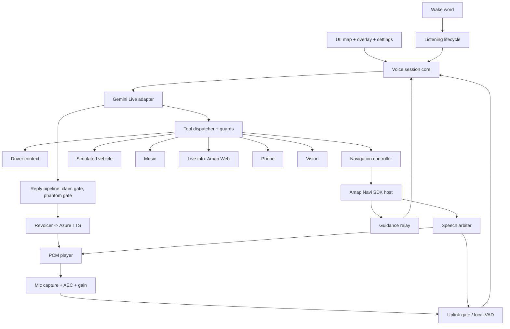
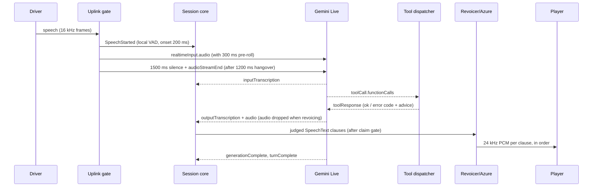

# Architecture

## Components

| Component | Responsibility | Android owner | Class (A–D) |
|---|---|---|---|
| Wake word | Detect the wake phrase offline while idle | `A/wake/IflytekWakeWordDetector.kt`, `WakeWordController.kt`, `WakeArming.kt` | C (iFlytek MSC Android SDK) |
| Listening lifecycle | ACTIVE / SILENT_WAIT / SLEEP / DEEP_IDLE timers and local phrases | `A/voice/ListeningLifecycle.kt`, `ListeningIntent.kt` | A |
| Audio capture | 16 kHz mono PCM16, 10 ms frames, gain, AEC | `A/voice/PcmAudioCapture.kt`, `WebRtcAcousticEcho.kt`, `MicInputGain.kt` | B |
| Uplink gate (local VAD) | Decide which audio is sent; supplies speech start/stop for Gemini | `A/voice/SpeechUplinkGate.kt` | A |
| Realtime session core | Provider-neutral state machine, reconnect, barge-in | `I/VoiceSessionController.kt`, `VoiceSessionStateMachine.kt`, `ReconnectPolicy.kt` | A |
| Provider adapter | Gemini Live WebSocket protocol | `A/voice/GeminiLiveClient.kt`, `GeminiLiveProtocol.kt` | A (protocol) + B (socket) |
| Reply pipeline | Claim/hold gate, phantom-turn gate, revoicer | `A/voice/DriverTurnPipeline.kt`, `PhantomTurnGate.kt`, `AssistantVoiceRevoicer.kt` | A |
| TTS | Azure REST SSML, 24 kHz PCM | `A/voice/AzureSpeechVoice.kt` | A (HTTP) |
| Playback | Epoch-based PCM player, guidance lane, focus | `A/voice/PcmAudioPlayer.kt`, `AudioFocusController.kt` | B |
| Speech arbiter | Who may speak/listen: assistant vs Amap guidance vs driver | `A/voice/SpeechArbiter.kt`, `SpeechAuthority.kt` | A |
| Tool dispatcher + guards | Validate and execute tool calls, refuse unsafe ones | `A/AndroidToolDispatcher.kt`, `A/ToolCallGuards.kt`, `A/tools/*` | A |
| Driver context | Referents from ok tool results, ambiguity resolution | `A/voice/DriverContext.kt`, `ContextResolver.kt`, `VoiceContextHints.kt` | A |
| Claim guards | Correct unverified claims | `A/voice/ActionClaimGuard.kt`, `GeminiCorrectionGrace.kt`, `EmptyResponseRetryPolicy.kt` | A |
| Navigation controller | Phase machine search→pick→route→navigate | `A/nav/EmbeddedNavigationController.kt`, `NavigationPhase.kt` | A (logic) |
| Amap host | Embedded Navi SDK view, route calc, guidance | `A/nav/amap/AmapNaviViewHost.kt` | B/C (Amap SDK) |
| Amap Web client | POI, around, polygon, weather, regeo, static map | `A/AmapPoiClient.kt`, `A/LiveInfoTool.kt` | A (REST) |
| Guidance relay | Assistant speaks Amap guidance or falls back to Amap TTS | `A/nav/GuidanceRelay.kt`, `nav/amap/AmapGuidanceVoice.kt` | A + B |
| Vehicle (simulated) | Climate, seat, window state | `simulator/.../SimulatedVehicleControl.kt`, `A/vehicle/*ToolHandler.kt` | A |
| Music | Bundled track; media-session search + read-back | `A/BundledMusicPlayer.kt`, `A/media/*` | C (other apps' media sessions) |
| Phone | Contacts lookup, confirm, dial | `A/PhoneCallTool.kt`, `AndroidContacts.kt` | C |
| Vision | Camera frame → Qianfan VLM | `A/vision/*` | B |
| UI | Map screen, overlay bubble, status chip, choice overlay, dev settings | `A/ui/*`, `DeveloperSettingsActivity.kt` | B |
| Persistence | SharedPreferences + Keystore AES-GCM secrets | `AndroidKeystoreCredentialStore.kt`, `*Settings.kt` | B |
| Background | Foreground service type microphone | `VoiceSessionService.kt` | C (iOS has no equivalent) |

A = platform-independent, reusable logic (port as Swift, same behaviour). B = platform-specific but
reproducible. C = Android-only capability (needs a different design or is unavailable). D = unverified
(see open-questions.md).

## Dependency graph

## Turn data flow (Gemini, active configuration)

## State machines

See contracts/voice-agent.md (session, listening lifecycle, turn) and contracts/navigation.md
(navigation phases). Diagrams are kept there, next to the event tables.

## Concurrency assumptions (Android)

- Session core events are serialised under one mutex (`I/VoiceSessionController.handleEvent`).
- Gemini turn state is guarded on the WebSocket reader thread; events go out on a SharedFlow (buffer
  1024, drops counted).
- Capture runs on its own thread with 10 ms frames; playback on a worker thread with non-blocking writes.
- Navigation uses one lock plus generation counters; SDK calls happen outside the lock and stale
  callbacks are dropped by generation.
- Playback uses **epochs**: every barge-in or cancel increments the epoch; audio from older epochs
  is discarded. iOS must keep this mechanism; it is what makes interruption instant.

## Error boundaries

| Boundary | Behaviour |
|---|---|
| Provider socket | Classified errors; RETRYABLE → reconnect (5 attempts, 200 ms doubling, 8 s cap); auth/quota/malformed → terminal with a config banner. |
| Tool execution | Every failure is an `ok=false` result with a code; `ToolFailureAdvice` gives the model the sentence to say. Never thrown to the session. |
| TTS | Azure failure: subtitle still shows, no fallback to Gemini voice. |
| Navigation SDK | Calc failure → ERROR phase with code; late callbacks dropped. |
| Capture/AEC | Read error → `AUDIO_CAPTURE_FAILED`; AEC failure stops capture. |

## Persistence

| Data | Android | iOS (PROPOSED) |
|---|---|---|
| Non-secret settings (model, voice, consent, style, saved places, guidance flags) | SharedPreferences | UserDefaults |
| Secrets (Gemini, Azure, Amap Web, iFlytek app id, vision key) | Keystore AES-GCM, base64 in prefs | Keychain (`kSecAttrAccessibleAfterFirstUnlock`) |
| Wipe all | `CredentialWipe.clearAll` | Same list of keys, one action |
| Conversation | In memory only; Gemini resumption handle in memory only | Same |
