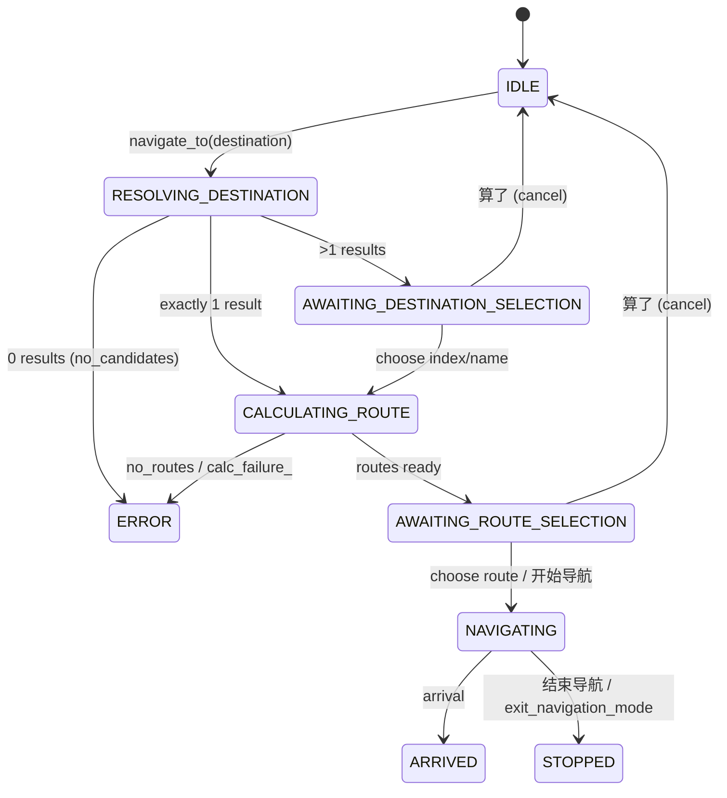

# Contract: navigation (v1, 2026-10-22)

## Phases (`A/nav/NavigationPhase.kt`)

`IDLE, RESOLVING_DESTINATION, AWAITING_DESTINATION_SELECTION, PLANNING_ROUTE, CALCULATING_ROUTE,
AWAITING_ROUTE_SELECTION, ROUTE_READY, NAVIGATING, ARRIVED, STOPPED, ERROR`. There is no CANCELLED
phase: cancel resets to IDLE. "Session active" = PLANNING_ROUTE, CALCULATING_ROUTE, ROUTE_READY, NAVIGATING.

## Rules

- **Generation counter**: every new request or cancel increments it; any result or SDK callback with
  an older generation is dropped (`nav_flow_late_result_dropped`). Required on iOS.
- **New destination while navigating**: stop old guidance first ("replaced"), then resolve.
- **Along-route list while navigating** (`requestCandidates`, keepGuidance): current guidance is kept;
  0 results or cancel restores it; the route is never replaced without an explicit pick.
- **Choice expiry**: a list older than 120 000 ms is refused (`OPTIONS_STALE`).
- **Choice kinds**: index (1-based, ≤10), preference {fastest, shortest, recommended, no_toll,
  fewest_lights, nearest}, name (exact → containment → fuzzy longest common run; AMBIGUOUS/NO_MATCH/
  OUT_OF_RANGE). Unmatched name may need a phonetic confirmation.
- **Local pick** (`NavigationPickerIntercept`): ordinals, preferences and `^(请|帮我|那就|好)?开始导航` are
  handled locally; duplicate model calls within 5 000 ms after a local pick are suppressed.
- **Dispatcher waits**: request 10 000 ms, options 8 000 ms.
- **Cancel semantics** (`endByVoice`): list open with kept guidance → close list only; NAVIGATING →
  stop guidance (STOPPED_NAVIGATION); cancellable phase → CANCELLED_SELECTION; else NOTHING_ACTIVE.
  After cancel the map must not keep drawing the route (P59).
- **Guards while navigating**: `NEARBY_QUESTION_WHILE_NAVIGATING` (a nearby/on-the-way *question* must
  not start `navigate_to`; 带我去附近的加油站 still may); `VAGUE_EXIT_WHILE_NAVIGATING`
  (`exit_navigation_mode` needs 结束/退出/停止 etc.).

## Tools

| Tool | Args | Result codes (non-exhaustive) |
|---|---|---|
| `navigate_to` | destination (≤120 chars) | candidates list, NO_CANDIDATES, HOME_NOT_SET, WORK_NOT_SET, AMAP_WEB_KEY_MISSING, NEARBY_QUESTION_WHILE_NAVIGATING |
| `choose_navigation_option` | exactly one of index / preference / name | OPTIONS_STALE, OPTIONS_NOT_READY, NO_OPTIONS_ON_SCREEN, ROUTE_CALCULATION_FAILED, START_FAILED, AlreadyNavigating |
| `exit_navigation_mode` | none | VAGUE_EXIT_WHILE_NAVIGATING |
| `save_place` | slot {home, work}, address | |
| `query_live_info` | kind {weather, route_traffic, along_route, place_details}, ... | NOT_NAVIGATING (route_traffic) |

## HUD fields (`A/nav/TextNavigationPanelModel.kt`)

Title 导航中 → destination; turn word + arrow (Amap icon type 2–16); step distance; 进入 {next road};
剩余 x.x km · duration; 限速 N km/h when limit > 0; last spoken guidance; "等待导航数据…" before first update.

## Overspeed

Limit = nearest camera with limit > 0 merged with facility limit. Alert 「您已超速，限速{N}公里」 on first
exceedance or limit change, min gap 10 000 ms. Limit 0 = no data, never overspeed.
**Unverified in CI**: US-hosted runs only see `limitKmh=0`.

## Guidance voice

See features/guidance-voice.md. Deadline 1 200 ms, cooldown 60 s after 2 consecutive deadline fallbacks,
fidelity strike limit 2, bracket 300 ms/char min 1 500 ms, echo window 10 s.
