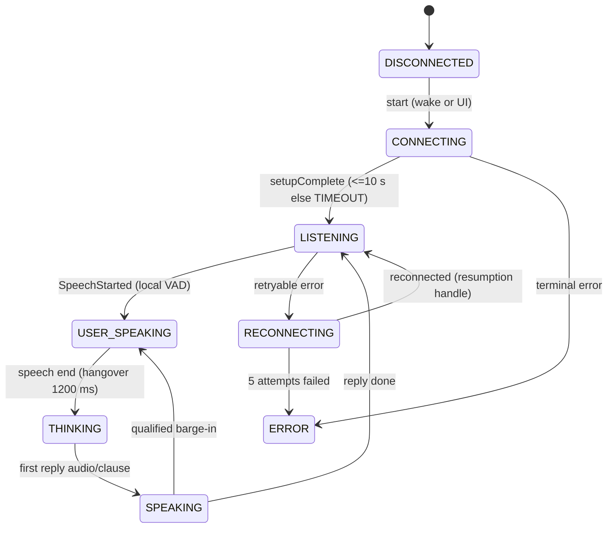

# Contract: voice agent (v1, 2026-10-22)

Shared, versioned behaviour of the voice session. A change here bumps the version and must be
reflected in every feature file that lists this contract under "Depends on".

## 1. Session UI states

`DISCONNECTED, CONNECTING, LISTENING, USER_SPEAKING, THINKING, SPEAKING, RECONNECTING, ERROR`
(`I/VoiceUiState.kt`). Chip mapping (`A/ui/AssistantUiStateMapper.kt`): DISCONNECTED→IDLE;
CONNECTING/RECONNECTING/THINKING→PROCESSING (amber); LISTENING/USER_SPEAKING→LISTENING ("聆听中");
SPEAKING→SPEAKING; ERROR→ERROR.

## 2. Listening lifecycle (`A/voice/ListeningLifecycle.kt`)

| From | Event | To | Notes |
|---|---|---|---|
| DEEP_IDLE | wake word / UI | ACTIVE | new session |
| SLEEP | wake word / UI | ACTIVE | same connection, context kept |
| ACTIVE | 「闭嘴」 | SILENT_WAIT | local phrase, whole utterance only |
| SILENT_WAIT | next real command | ACTIVE | |
| SILENT_WAIT | 20 s without real speech | SLEEP | |
| ACTIVE | 30 s idle | SLEEP | timers paused while busy; noise does not extend |
| ACTIVE/SILENT_WAIT | 「休眠」/「停止监听」 or `end_conversation` tool | SLEEP | |
| SLEEP | 5 min | DEEP_IDLE | closes the connection, **except while navigating** (connection kept) |

Audio is uploaded only in ACTIVE and SILENT_WAIT; replies are spoken only in ACTIVE. A deadline that
passes while busy fires 1.5 s after becoming idle. 「算了/取消」 are never intercepted locally.

## 3. Uplink gate (local VAD; Gemini has no server speech events)

Onset 200 ms, pre-roll 300 ms, hangover 1200 ms, evidence window 600 ms, RMS floor 120, noise factor
2.2, initial noise RMS 80, warm-up 1500 ms. Suspicious segment: <800 ms with voiced ratio <35%; held
<1200 ms with voiced ratio <60% (`A/voice/SpeechUplinkGate.kt:299-377`). On close: send 1500 ms of
digital silence, then `audioStreamEnd`.

## 4. Turn ordering (Gemini adapter, `GeminiLiveClient.onContent`)

1. A turn opens only on audio or a tool call; earlier output transcript is stashed.
2. Opening flushes the input transcript as `UserTranscript`, then `ResponseStarted`.
3. Reply audio/text passes the claim gate (`DriverTurnPipeline.filter`).
4. `generationComplete` → subtitle + `AudioDone`, verdict settles.
5. `interrupted` → `Interrupted(server_vad)` → turn closed "cancelled".
6. `turnComplete` → turn closed "completed" → `ResponseDone`.
Tool calls are never held. Duplicate calls get a duplicate instruction. Calls during a guidance
(app-prompt) turn are rejected.

## 5. Interruption priority (`A/voice/SpeechArbiter.kt`)

Reply decision, highest first: R4 permanent audio-focus loss → DROP; R6 navigating outside the 10 s
permitted window → DROP; R1 Amap guidance speaking → HOLD; R5 transient focus loss → HOLD; else PLAY.
Uplink: closed while guidance speaks + 500 ms tail, reopens after at most 20 s; R0 if the driver is
mid-utterance when guidance starts, uplink stays open up to 8 s. R6a workload hold: an unstarted reply
is held within 150 m of a manoeuvre for up to 8 s or until distance jumps >20 m.

Barge-in: on SpeechStarted during playback → invalidate playback epoch, flush, notify provider. Gemini
has no client cancel; its server sends `interrupted`. Unqualified barge-in is logged as residual echo.

## 6. Truthfulness gates

- Claim gate: reply audio + subtitle claiming an action are held until the matching `ok=true` result
  (I-1, I-5). Hold budget 120 events.
- `ActionClaimGuard`: one corrective nudge per utterance for: action asked but no tool call; claim after
  `ok=false`; partial scenario; 「导航已开始」 without evidence (`NAVIGATION_NOT_STARTED`); music
  unconfirmed (`MUSIC_NOT_CONFIRMED`); clarify referent; unverified claim.
- Correction grace: 20 000 ms when a tool call may follow, ≤1500 ms for chat turns.
- Empty response: one re-ask per utterance (「请回应我刚才说的话。」) after 3 s with no output; give up at 5 s.
- Phantom turn gate: short replies ≤12 CJK / ≤40 Latin chars; min transcript 2 chars.

## 7. Wait cues (`A/voice/WaitCues.kt`)

Visual cue at 3 s, 「收到，正在处理。」 at 7 s, delay line at 12 s, lost-turn window 60 s.

## 8. Reconnect

`I/ReconnectPolicy.kt`: 5 attempts, 200 ms initial, doubling, 8 s cap. Retryable: DISCONNECT,
CONNECTION, DNS, TIMEOUT, WS_FAILED, TLS_FAILED, UNAVAILABLE, RESUME_UNAVAILABLE. Terminal: auth,
credential, quota/rate, malformed/invalid model. A second error from the same dying socket joins the
reconnect in flight.

## Measured latency (evidence, not requirements)

Driver's last word → her voice 2.6–4.2 s on emulator (P48, 2026-10-08): end-of-speech detection 1.0–2.0 s,
Gemini first message 0–1.5 s, post-tool second turn 0.7–1.2 s, claim-gate hold 0.9–1.8 s. Azure first
audio warm 0.26–0.6 s. **No latency requirement is verified on a device**; treat these as the baseline
the iOS port must not exceed (see parity-matrix V-LAT).
